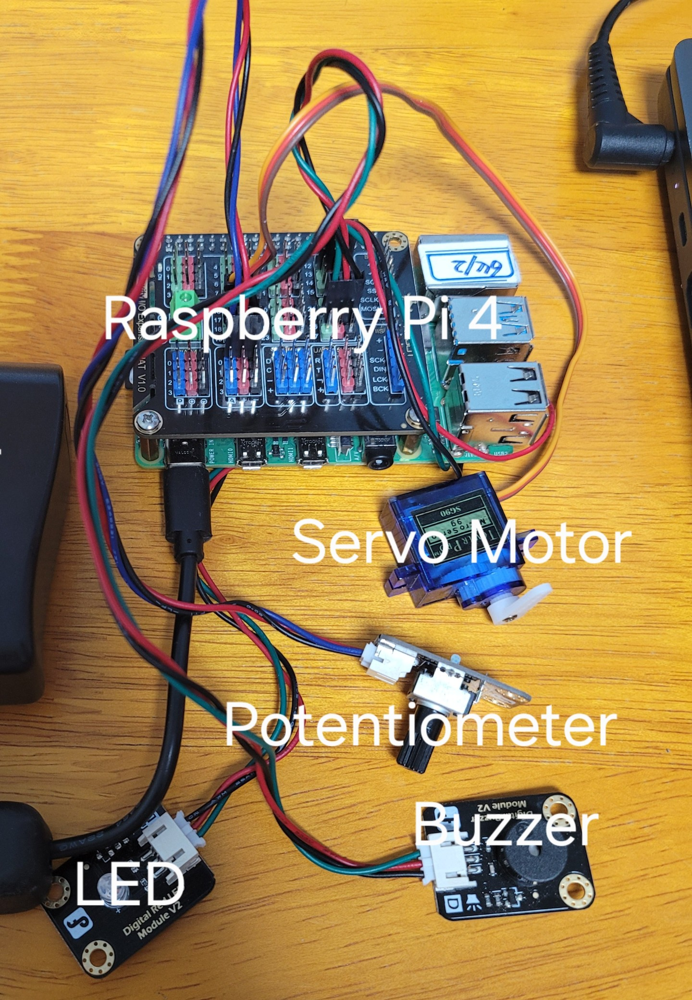

# RaspberryPi_Mechanical-ball-suspension
4학년 1학기 이산신호시스템설계 Project1 | 라즈베리파이를 활용한 쇠구슬 서스펜션 제어기 설계

<br>

## 1. 개요
- **프로젝트 성격:** 본질적으로 매우 불안정한 비선형 특성을 갖는 자기 부상 시스템을 수학적으로 선형화하고, 연속시간(CT) 및 이산시간(DT) 영역에서 제어 알고리즘을 설계하여 실제 임베디드 보드에 포팅하는 제어 공학 실증 프로젝트.
- **주요 성과:**
  - 기계·전기 복합 동역학 모델링 및 자코비안 선형화.
  - 상태 피드백 제어기, 피드포워드 보상기, Luenberger 상태 관측기 설계.
  - LQR/LQG 최적 제어 기법과의 성능 및 극점 궤적 비교 분석.
  - 영차 홀드(ZOH) 및 쌍선형 변환을 이용한 모델 이산화 및 안정도 한계점 도출.
  - 리눅스 커널 모드 인터럽트(HRTimer) 구축을 통한 하드 리얼타임 제어 주기 달성 및 HIL 실증.

<br>

## 2. 시스템 아키텍처

본 프로젝트는 수학적 모델링을 검증하는 **시뮬레이션 환경**과 이를 실제 장비에서 실시간으로 구동하는 **HIL(Hardware-in-the-Loop) 실증 환경**으로 나누어 구성되었습니다.

### 하드웨어 구조 (HIL)
카메라 비전 센서 및 고전압 전자석의 부재를 대체하기 위해, 센서 입력과 액추에이터 출력을 모사하는 실증 시스템을 구축하여 제어기의 성능을 검증했습니다.



- **입력 (가변저항):** 4초 주기로 스텝(Step) 입력을 생성하여 쇠구슬의 목표 간극($r$)을 제어기에 지시합니다.
- **제어/관측 (라즈베리파이 4):** 1ms/2ms 주기 인터럽트 내에서 가상 물리 엔진 연산 및 Luenberger 관측기를 통한 상태 추정을 수행합니다.
- **출력 (서보모터):** 보드 내부에서 연산된 가상 쇠구슬의 추정 위치($\hat{y}$)를 0~4cm 범위로 물리적으로 매핑하여 시각화합니다.
- **상태 확인 (부저/LED):** 제어기가 2% 오차 이내로 정착 시 LED를 점등하며, 발산 및 물리적 한계 초과 시 부저를 통한 긴급 차단(E-Stop)을 수행합니다.

<br>

### 디렉토리 구조
프로젝트는 범용 리눅스 환경의 한계를 극복하는 과정을 보여주기 위해, 유저 모드 구현과 하드 리얼타임을 보장하는 커널 하이브리드 모드로 분리하여 구성했습니다.

```text
├── docs/                    # 최종 보고서 및 발표 자료
│
├── simulations/             # MATLAB 기반 CT/DT 제어기 시뮬레이션 (Control System Toolbox 추가 설치)
│   ├── MBS_CT-Simulation.m 
│   └── MBS_DT-Simulation.m
|
└── src/                     # 임베디드 C 구현부 및 파이썬 파라미터 생성기 (HIL 실증)
    ├── 1_user-mode/         # [Step 1] OS 스케줄링 간섭이 존재하는 User Space 제어 구현
    │   ├── Makefile
    │   ├── generate_params.py
    │   ├── main.c 
    │   └── main2.c          # POSIX RTOS(SCHED_FIFO, mlockall) 적용 버전
    │
    └── 2_kernel-hybrid-mode/# [Step 2] HRTimer 기반 Kernel Mode ISR 통신 적용 구현
        ├── Makefile
        ├── generate_params.py
        ├── main.c           # 유저 스페이스: 복잡한 행렬 연산 및 소프트웨어 LPF 수행
        └── mbs_timer.c      # 커널 스페이스: 정밀 인터럽트 생성
```

<br>

## 3. 핵심 기능

### 1) CT Simulation: 수학적 모델링 및 제어기 설계
- **비선형 모델 선형화:** 전류의 제곱과 간극의 나눗셈으로 이루어진 비선형 운동 방정식을 동작점에서 테일러 급수로 선형화하여 상태 공간 모델을 도출했습니다.
- **분리 원리 적용:** 하드웨어 센서의 한계(속도, 전류 측정 불가)를 극복하기 위해 제어기 극점보다 5배 빠른 Luenberger 관측기를 결합했습니다.

### 2) DT Simulation: 시스템 이산화 및 안정성 검증
- **ZOH 이산화 한계 분석:** 샘플링 주기를 1ms, 5ms, 10ms로 변화시키며 시뮬레이션한 결과, 지연이 클수록 위상 지연이 누적되어 시스템이 발산함을 증명하였습니다.

### 3) DT Realization: 임베디드 리눅스 실시간 커널 포팅 (HIL)
- **커널 모드 ISR 적용:** 범용 OS의 스케줄링 간섭을 배제하기 위해, 유저 레벨 타이머(폴링) 대신 커널 공간의 `hrtimer`를 이용해 정확한 주기의 하드 리얼타임 동기화 시스템을 구축했습니다.


### 4) 구동 모드별 제어 성능(정착 시간) 비교
OS 스케줄링 간섭에 따른 제어 성능 저하를 검증하기 위해, 세 가지 구동 모드에서 동일한 스텝 입력(1.00cm)을 인가하여 2% 정착 시간을 측정 및 비교했습니다.

| 구동 모드 | 구현 방식 | 2% 정착 시간 | 특징 |
| :--- | :--- | :--- | :--- |
| **유저 모드** | `main.c` (Polling) | **0.513 s** | OS 스케줄링 간섭으로 인한 지터(Jitter) 발생 |
| **유저 RTOS 모드** | `main2.c` (SCHED_FIFO) | **0.499 s** | 프로세스 독점 및 메모리 락을 통한 지터 감소 |
| **커널 하이브리드** | `main.c` + `mbs_timer.c` | **0.484 s** | HRTimer 기반 Hard Real-Time 구현 (최고 성능) |

결과적으로 커널 레벨의 타이머(HRTimer)를 사용했을 때 지터가 최소화되어 가장 빠른 정착 시간(0.484s)을 달성함을 정량적으로 실증했습니다.

<br>

## 4. 트러블슈팅

### ① 샘플링 주기 변경에 따른 파라미터 하드코딩의 비효율성 해결
- **Symptom:** 매트랩에서 샘플링 주기나 동작점을 바꿀 때마다 산출된 제어기 및 관측기 행렬 이득값들을 C 코드에 일일이 수작업으로 수정(하드코딩)해야 하는 번거로움과 휴먼 에러 발생.
- **Root Cause:** 파라미터 연산 환경(Python)과 제어기 실행 환경(C)이 물리적으로 분리되어 있어, 설계 변경 시 데이터 파이프라인이 단절됨.
- **Resolution:** `Makefile`과 파이썬 스크립트를 연동하여, 빌드 시 파이썬이 시스템 행렬을 계산해 C 헤더 파일(`matrix_params.h`)로 자동 생성하도록 파이프라인을 자동화함.

### ② 실시간 제어 루프 내 파일 I/O로 인한 발산 원인 규명
- **Symptom:** 시뮬레이션 로그 분석을 위해 제어 루프 내부에서 CSV 저장을 시도했으나, 1ms로 설정된 제어 주기가 수십 ms씩 밀리며 시스템이 발산(추락)함.
- **Root Cause:** SD 카드나 파일 시스템에 접근하는 I/O 작업은 OS 차원에서 긴 블로킹 타임을 유발하며, 이는 실시간 제어 루프의 치명적인 지터로 직결됨.
- **Resolution:** 실시간 제어 루프 내 파일 I/O 코드를 전면 삭제하여 정확한 제어 타이밍을 확보함. 이를 통해 실무 환경과 동일하게 RAM에 데이터를 적재하고 하위 우선순위 스레드에서 파일 입출력을 분리하는 실시간 아키텍처의 중요성을 검증.

### ③ 가변저항 연속 조작에 따른 정착 시간 오차 보정
- **Symptom:** 가변저항을 손으로 돌려 목표값을 변경할 때, 시스템의 누적 시간 측정 로직이 꼬여 정착 시간이 비정상적으로 길게 측정되거나 초기화출력 불량 발생.
- **Root Cause:** 이론상 스텝 응답은 0초에 순식간에 목표치가 변해야 하나, 실제 아날로그 가변저항은 램프 입력처럼 연속적으로 변하여 제어기가 목표값 갱신과 정착을 반복하게 됨.
- **Resolution:** 목표값이 연속적으로 변할 때는 타이머를 멈추고, 조작이 멈추는 순간을 스텝 입력의 시작점(0초)으로 간주하는 필터 알고리즘을 도입하여 평가 정확도를 대폭 향상함.

<br>

## 5. 실행 방법

### 1) 의존성 라이브러리 설치
파이썬을 통한 제어기 파라미터 자동 연산을 위해 다음 패키지 설치가 필요합니다.
```bash
sudo apt update
sudo apt install python3-pip
pip3 install numpy scipy control
```

### 2) 프로젝트 빌드
루트 디렉토리에서 `make` 명령어 하나로 파이썬 스크립트를 통한 상태 공간 행렬 자동 계산 및 헤더 파일 생성, C 코드 컴파일이 일괄적으로 수행됩니다.
```bash
# [유저 모드] 1_user-mode/ 혹은 [커널 하이브리드 모드] 2_kernel-hybrid-mode/ 에서
make
```

### 3) 시스템 실행
구동 모드에 따라 아래와 같이 실행합니다. (GPIO 및 하드웨어 제어를 위해 `sudo` 권한이 필수적입니다.)
```bash
# [유저 모드 실행 시]
sudo ./digital_twin

# [유저 모드 RTOS 실행 시]
sudo ./digital_twin2

# [커널 하이브리드 모드 실행 시]
sudo insmod mbs_timer.ko   # 커널 인터럽트 타이머 모듈 적재
sudo dmesg | tail -n 10   # 적재가 잘되었는지 커널 로그 확인
sudo ./digital_twin       # 유저 제어 애플리케이션 실행

sudo rmmod mbs_timer       # 종료 시 커널 모듈 해제
sudo dmesg | tail -n 10   # 해제가 잘되었는지 커널 로그 확인
```

<br>

## 6. 시연 영상 및 발표 자료

본 프로젝트의 수학적 수식 유도부터 최종 하드웨어 제어 포팅까지 전체 과정을 담은 기술 발표 및 시연 영상입니다. 

[](https://www.youtube.com/watch?v=_LKF-VQqSF0)


**⏱️ 주요 시연 구간 (Timestamps):**
- `25:38 ~ 27:36` : MATLAB 기반 제어기·관측기 Simulation
- `36:30 ~ 41:45` : Raspberry Pi 실제 Target 제어 시연

**📄 프로젝트 문서:**
- **발표 자료(PDF):** [MBS_PPT.pdf](./docs/MBS_PPT.pdf)
- **최종 보고서(Word):** [MBS_report.docx](./docs/MBS_report.docx)

<br>

## 7. 한계점 및 향후 개선 과제

### ① 동작점 선형화의 물리적 한계
- **한계:** 본 시스템은 특정 동작점(1cm) 부근에서 비선형(1/x²) 자력 모델을 선형화하여 설계되었습니다. 따라서 목표치가 동작점에서 크게 멀어질 경우 선형 모델의 예측 오차가 커져 하드웨어가 발산할 위험이 있습니다.
- **개선:** 더 넓은 제어 범위를 확보하기 위해 동작점 구간별로 제어 행렬을 교체하는 게인 스케줄링이나, 비선형 수식 자체를 보상하는 피드백 선형화 기법 적용이 필요합니다.

### ② 실시간 로깅 아키텍처 고도화
- **한계:** 실시간 제어 루프(ISR) 내에서 파일 입출력(CSV 저장 등)을 직접 수행할 경우 블로킹 작업으로 인해 치명적인 지터가 발생합니다.
- **개선:** POSIX 스레드(`pthread`)를 활용하여 제어 스레드와 로깅 스레드를 완전히 분리하고, 링 버퍼 또는 `kfifo`를 통해 커널과 유저 공간 간 비동기적으로 데이터를 전달하는 구조로 고도화할 계획입니다.

### ③ 에너지 최적화 제어 기법 적용
- **한계:** Ackermann 공식을 활용한 극점 배치 방식은 이미 안정적인 시스템의 원래 동역학마저 강제로 억압하여 제어기(모터)에 무리한 전압 출력을 유발하고 오버슈트를 발생시킵니다.
- **개선:** 에너지 최적화와 노이즈 증폭 방지가 가능한 LQG(LQR + Kalman Filter) 제어 기법을 하드웨어 C 코드 상에 포팅하여 전력 소모를 최소화하고 안정성을 극대화하는 후속 연구가 요구됩니다.

<br>

## 8. 결론
본 프로젝트를 통해 본질적으로 불안정한 비선형 시스템을 상태 공간 모델로 구축하고, 최적 제어기(LQR)와 관측기 설계를 통해 안정화하는 전체 주기를 수행했습니다. 단순 매트랩 시뮬레이션을 넘어, ZOH 기반 이산화 특성을 분석하고 커널 모드 타이머(HRTimer)를 구축하여 실시간성을 확보하는 실무적인 임베디드 제어 시스템 통합 역량을 습득할 수 있었습니다.

---

## 9. 팀원 및 역할
- **김태준(조장):** 프로젝트 총괄, CT/DT 시뮬레이션, 하드웨어 실증 및 커널 모드 포팅
- **나승엽:** 기계·전기 복합 시스템 수학적 모델링, 동작점 및 평형점 해석 
- **오세범:** 상태 피드백 제어기 설계, 시스템 안정도 판별 후 정상상태 오차 제거용 피드포워드 보상기 설계
- **이찬중:** 관측기 이득 극점 배치 최적화, DT 변환 및 커널 모드 ISR 구축 지원
